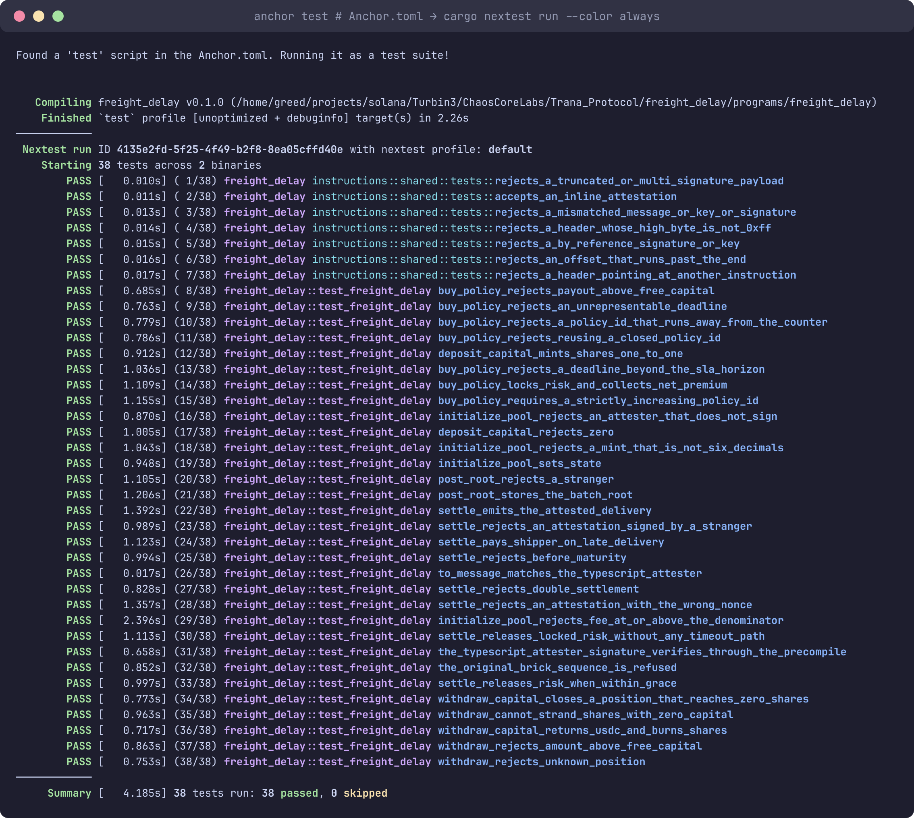
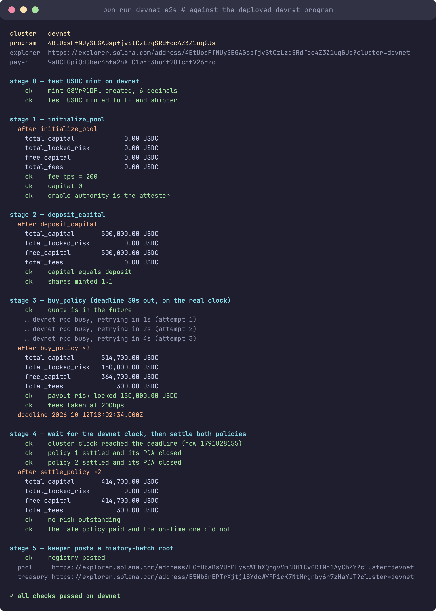
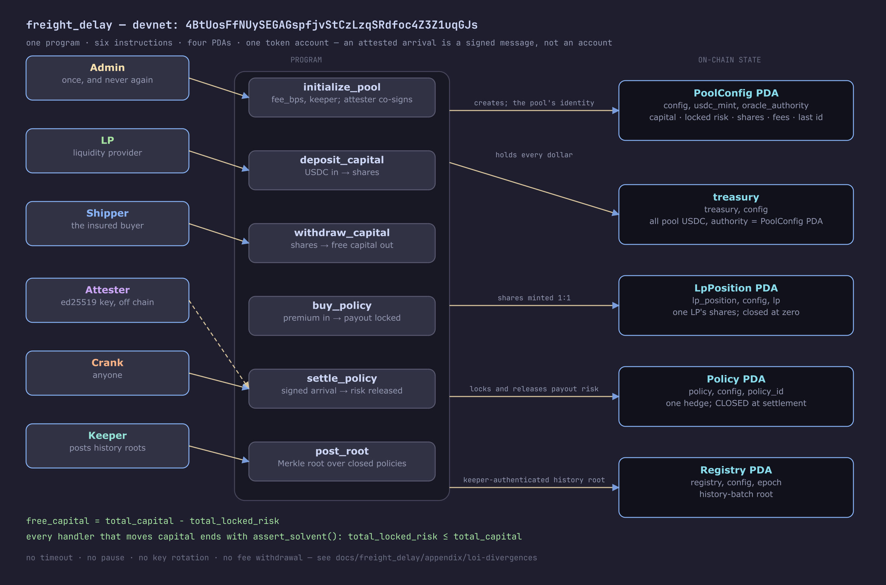
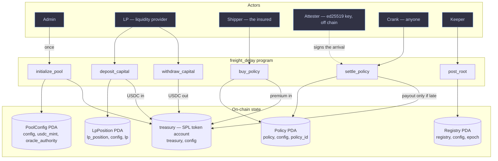

# Freight Delay

A parametric freight-delay indemnity protocol on Solana.

One pool per USDC mint. Liquidity providers deposit USDC and receive shares.
Shippers buy a policy that pays out when the attested arrival for their shipment
lands past the quoted delivery time plus a grace period. A single oracle
authority writes those delivery milestones, and settlement is permissionless —
anyone can crank it once a policy's deadline has passed.

The pool is **fully collateralised at all times**: every outstanding payout is
backed by capital the pool already holds, and that invariant is re-checked after
every state change.

This repository holds the Anchor program and its documentation site. There is
no frontend, SDK, or indexer.

## Deployed on devnet

| | |
|---|---|
| Cluster | `devnet` |
| Program ID | `4BtUosFfNUySEGAGspfjvStCzLzqSRdfoc4Z3Z1uqGJs` |
| Owner | BPF Upgradeable Loader (`BPFLoaderUpgradeab1e11111111111111111111111`) |
| ProgramData | `2kd8QbYc9EA2EjTibvzBU9i7KFwHdGTY4gakNeT6SauV` |
| Upgrade authority | `9aDCHGpiQdGber46fa2hXCC1wYp3bu4f28Tc5fV26fzo` |
| Deployed | 2026-10-12, slot `510345988`, 304,344 bytes of program data |

[Program on Solana Explorer](https://explorer.solana.com/address/4BtUosFfNUySEGAGspfjvStCzLzqSRdfoc4Z3Z1uqGJs?cluster=devnet)

```bash
cd freight_delay
anchor deploy --provider.cluster devnet   # the checked-in keypair already holds this id
bun run devnet-e2e                        # whole lifecycle against the deployed program
```

The program id is the same on localnet and devnet because the deploy reuses
`target/deploy/freight_delay-keypair.json`: no `declare_id!` edit, so every PDA
derives identically on both clusters.

## Tests

Everything green is reproducible with two commands:

| Evidence | Command | Result |
|---|---|---|
| LiteSVM suite (in-process, the same `.so` the deploy ships) | `anchor build && cargo nextest run` | **38 passed**, 0 failed |
| Devnet end-to-end: `initialize_pool` → `deposit_capital` → `buy_policy` ×2 → `settle_policy` (late + on-time) → `post_root` | `bun run devnet-e2e` | **all checks passed on devnet** |





The suite runs against the program binary in-process, so it exercises every guard
and every error path without paying fees; the devnet run proves the same binary on
a real cluster, with real fees, real confirmation and the real clock — there is no
time travel on devnet, so it buys a policy whose deadline is seconds away and
waits for the chain clock to pass it.

## Architecture

One program, six instructions, four PDAs and one token account. Nothing else is
on chain: an attested arrival is a signed message, not an account.



<details>
<summary>Diagram source (mermaid)</summary>



</details>

| Actor | Reaches the program by | Can it be replaced? |
|---|---|---|
| Admin | `initialize_pool(fee_bps, keeper)` — the attester co-signs, because its key seeds the pool address | No: no setter instruction exists, by design |
| LP | `deposit_capital`, `withdraw_capital` | n/a — per-LP position account |
| Shipper | `buy_policy`; receives the payout and the closed policy's rent | n/a |
| Attester | Nothing. It signs `(pool, shipment_id, actual_delivery, terminal_code, nonce)` off chain | No — see *Key rotation* below |
| Crank | `settle_policy` — permissionless; the worst a leaked crank key does is pay someone else's fees | Anyone |
| Keeper | `post_root` — writes history-batch roots | No, by design |

| On-chain object | Seeds | Holds |
|---|---|---|
| `PoolConfig` | `[config, usdc_mint, oracle_authority]` | The accounting hub: capital, locked risk, shares, fees, the last policy id |
| treasury | `[treasury, config]` | Every USDC the pool owns; the `PoolConfig` PDA is its authority |
| `LpPosition` | `[lp_position, config, lp]` | One LP's shares; closed when it reaches zero |
| `Policy` | `[policy, config, policy_id_le]` | One hedge's terms; **closed at settlement**, its record surviving as the `PolicyClosed` event |
| `Registry` | `[registry, config, epoch_le]` | A Merkle root over a batch of closed policies, so the off-chain history is provable |

Money moves one way and is checked after every step:

```text
   premium in ─────► treasury ─────► payout  (only when the attested arrival is late)
                        │       └───► LP redemption (only from free capital)
                        │
   free_capital = total_capital - total_locked_risk
   invariant    : total_locked_risk <= total_capital   (assert_solvent, after every
                                                        handler that moves capital)
```

The design is documented page by page in the site under
[`docs/freight_delay/`](docs/freight_delay): `protocol/architecture` for the object
graph, `protocol/instructions` for every guard, `protocol/invariants` for the
accounting rules, and `appendix/loi-divergences` for what is deliberately absent
(no timeout, no pause, no key rotation, no fee withdrawal).

## Layout

```text
.
├── freight_delay/             # the freight-delay Anchor program and its tests
├── docs/                      # the documentation site
├── LOI_DELIVERABLE_FREIGHT_DELAY.md  # the program's design intent
├── mise.toml                  # pinned toolchain (agave, anchor fork, surfpool, nextest, sccache, bun)
├── rust-toolchain.toml        # pinned Rust channel + components
└── .cargo/config.toml         # sccache as the rustc wrapper
```

`mise.toml`, `rust-toolchain.toml`, and `.cargo/config.toml` live at the root and
apply to the program.

Each directory documents itself:

- **[`freight_delay/README.md`](freight_delay/README.md)** — the program:
  layout, toolchain, build and test, the instruction set, accounts, accounting
  rules, and what the program deliberately does not do.
- **[`docs/README.md`](docs/README.md)** — the documentation site: how to run it,
  the section structure, the theming, how diagrams are rendered, and the checks
  it runs.

## Quick start

```bash
mise trust                  # once per clone: mise gates config files by path
mise install                 # agave, anchor, surfpool, nextest, sccache, bun

cd freight_delay
anchor build                 # -> target/deploy/freight_delay.so
cargo nextest run            # 38 tests: 31 LiteSVM + 7 unit
bun run devnet-e2e           # the same lifecycle against the devnet deployment

# The documentation site.
cd ../docs
bun install
bun run dev                  # http://localhost:5173
```

`anchor build` must run before the tests: they load `target/deploy/freight_delay.so`
at compile time, so a stale build silently tests old code.

## Reading the documentation

The docs site is the reference for the protocol, split into one top-level
section with its own left-hand tree. Pages worth knowing first:

- `docs/freight_delay/protocol/instructions.md` — every instruction with its full
  guard list
- `docs/freight_delay/protocol/invariants.md` — the accounting rules the program
  enforces
- `docs/freight_delay/appendix/loi-divergences.md` — what the program
  deliberately does not implement

## A note on the design document

`LOI_DELIVERABLE_FREIGHT_DELAY.md` is the original proposal, **not** a
specification. It describes features that were never built — a withdrawal
cooldown, a `TreasuryVault` account, governance setters for the fee and oracle
authority, and Switchboard TEE oracles. Read it for vocabulary; treat
`freight_delay/programs/freight_delay/src` as the truth, and see the
`appendix/` page for the divergences.
