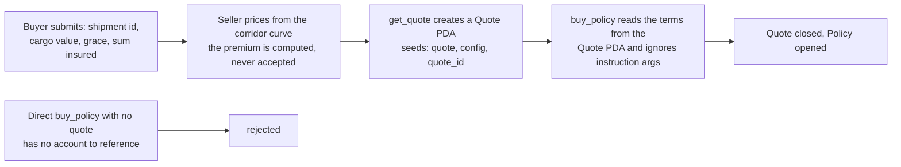

# Open Findings

Holes in the shipped program, and the options considered for closing them. This
page is a record, not a roadmap: **nothing below is implemented**, and `src/` is
still the specification. It exists so the next reader does not have to re-derive
the same analysis.

Each finding states what the code does today, what follows from it, and what the
candidate fixes are — including the ones rejected or deferred.

## Finding 1 — `buy_policy` accepts unauthenticated terms

### What the code does

`buy_policy` is permissionless, and every term is an instruction argument:
`expected_delivery`, `grace_period`, `payout_amount`, `premium_amount`. Nothing
links the premium to the payout, and nothing authenticates that anyone other than
the caller chose the terms.

| Guard (`instructions/buy_policy.rs`) | Condition |
|---|---|
| `payout_amount != 0` | passes for any non-zero payout |
| `premium_amount != 0` | passes for **one base unit** |
| `expected_delivery > now` | caller sets it one hour out |
| `grace_period >= 0` | caller sets 0 or 1 day |
| `expected_delivery + grace_period <= now + MAX_SLA_SECONDS` | 365 days |
| `policy_id` in `(last_policy_id, last_policy_id + MAX_POLICY_ID_GAP]` | read the config, take the next id |
| `free_capital() >= payout_amount` | **the only real gate** |

The fee is `premium_amount * fee_bps / 10_000`, so a one-base-unit premium floors
to **zero** fee. Entry costs the attacker one base unit (0.000001 USDC) plus the
policy account's rent-exempt minimum (roughly 0.002 SOL).

### Worked example

```text
policy_id        = last_policy_id + 1
shipment_id      = 0
expected_delivery= now + 1 hour
grace_period     = 1 day
payout_amount    = 100,000 USDC
premium_amount   = 1 base unit        (0.000001 USDC)
```

Every guard passes. The pool now carries a 100,000 USDC liability that cost one
millionth of a USDC, and it holds that liability against whatever `free_capital`
the pool happened to have.

### What follows

| Attack | Needs a key? | Result |
|---|---|---|
| Take the payout | **yes** — one ed25519 signature from `oracle_authority` | 100,000 USDC leaves the treasury for 0.000001 USDC |
| Freeze the capital | **no** | the payout is locked in `total_locked_risk`, outside `free_capital`, permanently |

The second row is the serious one, because it needs no key at all.

`settle_policy` verifies an ed25519 signature against `PoolConfig.oracle_authority`
and nothing else, and the attester in `attester/` signs whatever payload it is
handed — the caller supplies the seed and every field, and nothing checks that the
`nonce` corresponds to a policy anyone quoted. So a loose signing process, or one
colluding insider, converts the first row into outright theft.

Without a signature, the policy can never settle. There is no timeout (CHA-15),
no cancel, and no admin path, so the payout stays in `total_locked_risk` forever —
outside `free_capital`, and therefore beyond the reach of `withdraw_capital`. And
because the capital gate passes at *equality*, a single call leaves the pool with
about 1 base unit of free capital: no further policy can be written, and LPs can
withdraw essentially nothing.

For one base unit and the price of rent, an attacker permanently freezes the
whole pool.

### What cannot happen

Be precise about the bound:

- **No insolvency.** `total_locked_risk <= total_capital` still holds, so the pool
  never owes more than it holds.
- **No theft beyond `free_capital`.** The entry gate caps the payout at the pool's
  unencumbered capital.
- **No zero-capital brick.** The gate is checked before the net premium is
  credited, so `free_capital > 0` survives while shares remain.

That is also why the existing suite cannot see it: the invariant holds under this
attack. The failure mode is frozen funds, not a broken invariant.

### Options

#### Option A — seller-authored terms: a `get_quote` instruction and a `Quote` PDA

The real fix. The seller's key authors the terms and writes them on chain; the
buyer can only accept them.



A `Quote` PDA would carry `shipment_id`, `expected_delivery`, `grace_period`,
`payout_amount`, `premium_amount`, `expires_at` and a `buyer` (or `OPEN` for a
published quote any buyer can accept). Four rules make it work:

1. **Terms come from the account, not the arguments.** `buy_policy` reads the
   quote's fields and ignores — or asserts equality with — the instruction args.
   Otherwise the attacker passes a real quote id alongside fake numbers.
2. **One quote, one policy.** Close the `Quote` PDA on purchase, returning rent.
   Otherwise one cheap quote is reusable.
3. **An expiry.** `expires_at` stops a stale quote being bought after the
   corridor's risk has changed — a strike, a known weather event.
4. **Bind the buyer, or leave it `OPEN`.** A named buyer reserves the trade; an
   open quote is what lets the seller's terms be accepted without the seller being
   online.

| Property | Without a quote | With a quote |
|---|---|---|
| Who sets the price | the buyer | the seller |
| Seller online at purchase | yes | no |
| Stale pricing after a strike | possible | bounded by `expires_at` |
| A published quote can be shopped | no | yes, if `OPEN` |

**Cost.** This adds a signing key, which the program currently avoids everywhere
(see the "no governance setters" divergence in [LOI vs Code](./loi-divergences)).
Two things to get right:

- **Keep the quote key separate from the attester key.** One key that both writes
  the terms and signs the arrivals can mint a fraudulent policy and settle it — a
  full drain of the treasury.
- **Prefer a new immutable `underwriter` over reusing `PoolConfig.admin`.** `admin`
  is written at initialisation and never read; giving it this power would silently
  activate a field nothing else depends on.

The name is provisional: `get_quote` reads like a query, but the instruction
*writes* — a quote is an account, not a return value. A pure read could not be
trusted by `buy_policy` at all.

#### Option B — minimum rate floor and payout cap

A stopgap that needs no new account, no new key and no new instruction:

```text
premium_amount * 10_000 >= payout_amount * MIN_RATE_BPS
payout_amount  <= total_capital * MAX_POLICY_BPS / 10_000
```

The floor makes griefing expensive — a 100,000 USDC payout would carry a real
premium, so freezing the pool stops being free. It does **not** stop theft: an
attacker who holds or can obtain a signature still profits, just at a stated rate.

#### Option C — a timeout or expiry path (CHA-15)

Already recorded as missing. On its own it does not close this hole, but it is
what makes the freeze temporary instead of permanent: a policy that cannot be
settled would release its locked risk after a bound, returning the capital to
`free_capital`. See [Invariants](../protocol/invariants) for why a timeout was
deliberately left out and what it costs.

## Finding 2 — nothing anchors the payout to the cargo

The buyer chooses `payout_amount`, so the pool's exposure is buyer-chosen too. The
program never sees the goods, and it cannot: no field, no account, no oracle
carries cargo data.

A shipment id does not close the gap. A bill of lading carries the corridor, the
carrier, container count, weight and HS code — but **not the value**, and
deliberately so, because a carrier's liability is capped per package. Value lives
in the commercial invoice and the customs entry, held by the buyer, their broker,
or their bank.

So the payout needs a ceiling from somewhere. Three options, in the order they are
worth considering:

| Option | How | Trade-off |
|---|---|---|
| **Fixed notional** | Sell a standard delay-indemnity unit of fixed size, priced by corridor and grace, with an absolute ceiling per policy | No value needed at all; the payout stops tracking the customer's real loss |
| **Derived bound** | `max payout = containers × per-container notional` (or weight, or an HS-code band) from manifest data | The buyer does not type any of it, so over-declaration is impossible; ±30–50% accurate |
| **Declared value** | Invoice, letter of credit or customs entry collected at quote time | Accurate and standard for insurance; real friction, and only justified once the payout is large |

Over-declaring value is the attack — a bigger payout for the same premium — so
whatever ceiling is chosen must be anchored to something the buyer does not
control, or be absolute.

### What the frontend should collect

| Field | Supplied by |
|---|---|
| Shipment id / corridor | buyer |
| Declared cargo value | buyer, with documents (if option 3 is used) |
| Grace period | buyer |
| **Premium** | **nobody — it is computed** |
| Payout | derived as a capped share of the declared or derived loss |

The seller's key, not the buyer and not the frontend, must enforce at least:
the premium is derived and never accepted; `payout <= 20% of cargo value`;
`payout <= 5% of pool capital` plus a per-corridor cap; and rows whose `P(late)`
exceeds roughly 15% are refused.

**The limit to state plainly.** Nothing on chain can verify a declared cargo
value. That is underwriting, and it stays an off-chain diligence process — the same
as any insurer asking for an invoice. What a `Quote` PDA buys is that the seller
*asserted* those terms with its own key, so the assertion is accountable. A quote
pipeline that mechanically republishes buyer input changes nothing and rebuilds the
original hole with an extra account.

## Related

- [LOI vs Code](./loi-divergences) — the other deliberate absences, including the
  missing timeout and the refusal to add governance setters
- [Scope & Status](../introduction/scope) — what the repository contains, and what
  is explicitly not implemented
- [Invariants](../protocol/invariants) — why the solvency invariant holds even
  under the attack above, and what it does not cover
- [Instructions](../protocol/instructions) — the guards `buy_policy` actually
  applies today
