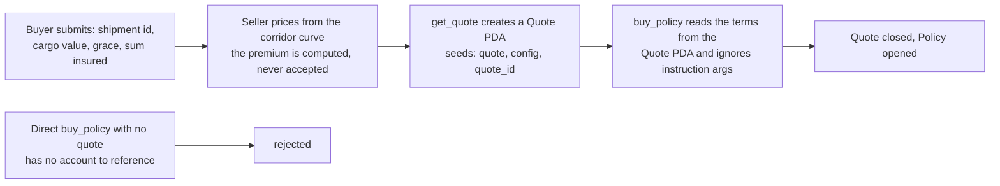

# Open Findings

What the program does not protect against, and what has been done about it. This
page is a record, not a roadmap: a closed finding states the fix that landed, an
open one states the options still on the table. `src/` remains the specification.

## Finding 1 — `buy_policy` accepted unauthenticated terms (closed)

### What was wrong

`buy_policy` was permissionless, and every term was an instruction argument:
`expected_delivery`, `grace_period`, `payout_amount`, `premium_amount`. Nothing
linked the premium to the payout, and nothing authenticated that anyone other than
the caller had chosen them.

Calling it directly with a 100,000 USDC payout, a 1 base-unit premium, a one-day
grace and an `expected_delivery` one hour out passed every guard: the fee floors
to zero, and the only real gate was `free_capital() >= payout_amount`. The pool
then carried a 100,000 USDC liability that cost one millionth of a USDC.

Two outcomes followed, and the cheaper one needed no key at all:

| Attack | Needed a key? | Result |
|---|---|---|
| Take the payout | yes — one ed25519 signature from `oracle_authority` | 100,000 USDC left the treasury for 0.000001 USDC |
| Freeze the capital | **no** | the payout sat in `total_locked_risk`, outside `free_capital`, permanently |

The second was the serious one. There is no timeout (CHA-15), no cancel and no
admin path, so a policy that can never settle keeps its payout out of reach of
`withdraw_capital` forever. And because the capital gate passed at *equality*, one
call left the pool with about one base unit of free capital: no further policy
could be written, and LPs could withdraw essentially nothing. For one base unit
and the price of rent, an attacker could permanently freeze the whole pool.

It was never an insolvency bug. The invariant held throughout, which is exactly
why the suite could not see it — the failure mode was frozen funds, not a broken
guarantee.

### The fix: `get_quote` and a `Quote` PDA

Terms are now authored by the seller and stored on chain; `buy_policy` reads them
from that account and takes no term as an argument.

Four rules make it hold, and each maps to one line of the program:

1. **The terms come from the account, not the arguments.** `buy_policy(policy_id,
   quote_id)` has no term to accept, so there is nothing left to underprice.
   Worse for an attacker, the `Quote` address itself proves provenance: it derives
   from `config.underwriter`, so only that key could have created it.
2. **One quote, one policy.** `buy_policy` closes the `Quote` PDA at acceptance, so
   a spent quote cannot be presented twice.
3. **An expiry.** `get_quote` requires `now < expires_at <= expected_delivery`, so
   terms cannot be accepted once the ship is due.
4. **A buyer binding, or none.** `buyer == Pubkey::default()` leaves the quote open
   to anyone; any other value reserves it.

The authoring/acceptance split is the substance of the fix. `get_quote` validates
the schedule (`expected_delivery` in the future, `grace_period >= 0`, the deadline
inside `MAX_SLA_SECONDS`), and `buy_policy` validates only whether the offer still
stands, whether this buyer may accept it, and whether the pool can carry the risk.

### What the fix does not cover

**The `underwriter` key is a new trust root.** It is a second signing key where the
program previously had one, and it must stay distinct from `oracle_authority`: a
single key that could both author the terms and sign the arrivals could mint a
fraudulent policy and settle it, draining the treasury. `initialize_pool` fixes
both keys, and neither can be rotated.

**An unaccepted quote has no close path.** An expired quote is never acceptable
again, and nothing reclaims its account or rent; the underwriter simply authors the
next quote under a different `quote_id`. Quote ids are caller-chosen and may be
reused once an account is closed, so the closed PDA — not the id — is what stops
one offer backing two policies.

**Expiry is the only lever against a better-informed buyer.** The program cannot
see where a vessel is, so it cannot tell a buyer who is quoting early from one who
already knows the ship is drifting. Bounding how long an offer stands is the whole
defence.

**The minimum-rate floor was considered and not built.** Charging
`premium_amount * 10_000 >= payout_amount * MIN_RATE_BPS` would have made griefing
expensive without stopping theft. With terms authored by the seller it has no job
left to do: the floor is now whatever the underwriter prices.

**There is still no timeout path (CHA-15).** A shipment that is never attested
leaves its payout locked indefinitely, and a quote change does not touch that.

## Finding 2 — nothing anchors the payout to the cargo (open)

The underwriter chooses `payout_amount`, so the pool's exposure is a seller
decision — an improvement over a buyer's, but still unanchored. The program never
sees the goods, and it cannot: no field, no account and no oracle carries cargo
data.

A shipment id does not close the gap. A bill of lading carries the corridor, the
carrier, container count, weight and HS code — but **not the value**, and
deliberately so, because a carrier's liability is capped per package. Value lives
in the commercial invoice and the customs entry, held by the buyer, their broker,
or their bank.

So the payout needs a ceiling from somewhere. Three options, in the order they are
worth considering:

| Option | How | Trade-off |
|---|---|---|
| **Fixed notional** | Sell a standard delay-indemnity unit of fixed size, priced by corridor and grace, with an absolute ceiling per policy | No value needed at all; the payout stops tracking the customer's real loss |
| **Derived bound** | `max payout = containers × per-container notional` (or weight, or an HS-code band) from manifest data | The buyer does not type any of it, so over-declaration is impossible; ±30–50% accurate |
| **Declared value** | Invoice, letter of credit or customs entry collected at quote time | Accurate and standard for insurance; real friction, and only justified once the payout is large |

Over-declaring value is the attack — a bigger payout for the same premium — so
whatever ceiling is chosen must be anchored to something the buyer does not
control, or be absolute.

### What the frontend should collect

| Field | Supplied by |
|---|---|
| Shipment id / corridor | buyer |
| Declared cargo value | buyer, with documents (if option 3 is used) |
| Grace period | buyer |
| **Premium** | **nobody — `get_quote` computes it** |
| Payout | derived as a capped share of the declared or derived loss |

The underwriter's key, not the buyer and not the frontend, must enforce at least:
the premium is derived and never accepted; `payout <= 20% of cargo value`;
`payout <= 5% of pool capital` plus a per-corridor cap; and rows whose `P(late)`
exceeds roughly 15% are refused.

**The limit to state plainly.** Nothing on chain can verify a declared cargo
value. That is underwriting, and it stays an off-chain diligence process — the same
as any insurer asking for an invoice. What the `Quote` PDA buys is that the seller
*asserted* those terms with its own key, so the assertion is accountable. An
authoring pipeline that mechanically republishes buyer input changes nothing, and
would rebuild the original hole with an extra account.

## Related

- [Instructions](../protocol/instructions) — the guards `get_quote` and
  `buy_policy` apply today
- [Accounts & State](../protocol/accounts) — the `Quote` layout and `PoolConfig`
- [Invariants](../protocol/invariants) — why the solvency invariant held even under
  Finding 1, and what it does not cover
- [LOI vs Code](./loi-divergences) — the other deliberate absences, including the
  missing timeout and the refusal to add governance setters
- [Scope & Status](../introduction/scope) — what the repository contains, and what
  is explicitly not implemented
