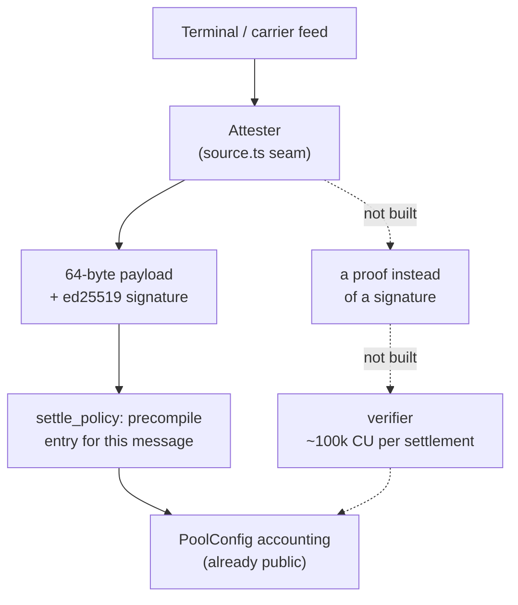

# ZK Research Notes

Is zero-knowledge a complementary feature for this protocol, and if it is, where
would it attach? This page is a research note, not a roadmap. Nothing described
here is planned, nothing in `src/` refers to it, and the repository contains no
circuit, no verifier and no proof-system dependency. `src/` remains the
specification, and this page is careful not to describe behaviour the program does
not have.

The short answer: **ZK is interesting here for two motives — confidentiality and
provenance — and for nothing the protocol already checks.** Everything the pool
verifies today is public state and cheap arithmetic, which is exactly the work a
proof system cannot improve and does make more expensive.

## Why it buys nothing for the checks that exist

| Check | Why a circuit adds nothing |
|---|---|
| `total_locked_risk <= total_capital` | public state; the check is a subtraction |
| the attester binding — pool prefix in the signed bytes, `nonce == policy.policy_id` | already cryptographic, already free |
| the trigger — `actual_delivery > expected_delivery + grace_period` | one comparison |
| a policy's inclusion in a `Registry` epoch | a Merkle proof already answers it |
| that a signature is genuine | the ed25519 precompile already answers it, in native code |

ZK proves a computation over **hidden inputs**. This program's inputs are public by
construction, so a circuit would add an off-chain prover, on the order of 100k
compute units per verification, a new dependency and a new audit surface — in
exchange for nothing.

## Motive 1 — confidentiality

`PolicyClosed` is a public terminal record: `shipment_id`, `expected_delivery`,
`grace_period`, `payout_amount`, `premium_amount`, the outcome and the attested
`actual_delivery`, plus `terminal_code` inside the signed payload. For a pool whose
members are freight forwarders and D2C brands, that is a feed of who ships what,
where, and how reliably. ZK is the only mechanism that proves "this shipment was
late" without disclosing which lane was late.

Where it would attach, and what it would disturb:

| Seam | Today | With a proof |
|---|---|---|
| `Quote` / `Policy` terms (`state.rs`) | plaintext `shipment_id`, `expected_delivery`, `grace_period`, `payout_amount` | commitments; the trigger becomes a proof over committed values |
| the trigger in `settle_policy` | `attestation.actual_delivery > deadline` | a proof that the committed arrival exceeds the committed deadline |
| `PolicyClosed` and the leaves `post_root` hashes | the full record in plaintext | the leaf becomes a commitment; the history loses its readable audit trail |
| the crank | permissionless: anyone reads a `Policy` PDA and settles it | needs a nullifier and a discovery path, or a relayer that can see what to settle |

Two consequences are worth stating before any of this looks attractive:

- **Underwriting needs the lane.** A price comes from the corridor, the transit
  time and the season. Privacy pushes pricing further off chain. `get_quote`
  already allows that — the underwriter authors terms with its own key and only
  the result is on chain — but the pool's risk book stops being auditable by its
  own LPs, and an epoch root over commitments proves strictly less than a root
  over plaintext.
- **The accounting is not the secret.** Even with private terms, a payout is still
  a movement out of the treasury, so the timing and size of capital movement stay
  visible. Hiding those is a second, larger change (see below).

## Motive 2 — provenance

The weakest assumption in the protocol is one key: `oracle_authority` signs the
arrival, and `settle_policy` trusts it exactly as signed. A proof could reduce what
that key is trusted for — but only if the source data is verifiable to begin with.

- **If the terminal or port authority signed its own data**, no ZK is needed: the
  program would verify *their* signature instead of the attester's. That is a
  smaller change than any circuit, and it is the path to prefer if a feed ever
  offers signatures.
- **If it does not**, the only route is proof-of-HTTPS-response (zkTLS): prove that
  a specific API response contained the arrival, without publishing the session.
  Tooling for this exists with on-chain verification support for Solana, but the
  trust does not disappear — it moves to the counterparty whose TLS session is
  being attested, and to the attestor or proxy that helps produce the proof. It
  also means a circuit per response shape, a maintenance commitment no protocol
  wants on its settlement path.

Either way the seam is the same two places: `attester/src/source.ts`, where an
`ArrivalSource` produces the arrival, and `shared.rs`, where
`verify_ed25519_attestation` and the 64-byte `to_message` layout would be replaced
by a verifier and whatever payload it checks.

## What it would cost

- **On chain.** Solana has the `alt_bn128` syscalls from 1.18 onward, active on
  mainnet-beta, so Groth16 verification is practical inside a program. The
  `groth16-solana` verifier measures 78,293–108,762 CU for 1–8 public inputs
  (134,764–165,236 CU for the BSB22 variant), and a proof is a constant 128 bytes,
  the current path charges per ed25519 signature through the precompile, and the
  introspection parse in `shared.rs` is orders of magnitude cheaper than a
  verifier.
- **Off chain.** Proving time, plus circuits to write, review and maintain. Both
  are new categories of work here: the program's dependency list is four crates on
  purpose (`anchor-lang`, `anchor-spl`, `solana-instructions-sysvar`,
  `solana-sdk-ids`, the last two already in the tree via anchor-lang), and there is
  no proving infrastructure at all.
- **In the trust model.** A verifier joins the settlement path, with its own bug
  classes. The seven unit tests on `shared.rs` would not carry over.

## What would come first

If the worry is "one key is trusted" rather than "the lane must stay secret", ZK
is the last answer to reach for, not the first. Cheaper options, and the ones
comparable protocols use:

| Option | What it buys | Rough shape here |
|---|---|---|
| k-of-n attesters | no single key can forge an arrival | N keys over the same payload, signatures accumulated in an account, then a threshold check — the shape bridges use for guardian quorums |
| attester bond + dispute window | economic cost to lying, and a way to contest | a bond account and a settlement delay; needs an authority to adjudicate, which this program deliberately lacks |
| TEE attestation | hardware-rooted honesty | what the design document named; the program verifies the enclave's signature exactly as it verifies the attester's today |

For confidentiality alone the first step needs no proofs at all: commit the lane
(`shipment_id` or a corridor id) and keep the plaintext with the underwriter off
chain. Hiding **amounts** is a token-level feature rather than a circuit —
Token-2022's confidential-balance extension encrypts balances and transfer amounts
using client-generated proofs, while leaving addresses public. This pool is
denominated in plain SPL USDC (`anchor_spl::token::Token`), so adopting it would
mean a token-program change in every instruction that names `usdc_mint`.

## The decision that has to be made before it matters

`PoolConfig`'s address is seeded by the attester's key:
`[CONFIG_SEED, usdc_mint, oracle_authority]`. Changing *who* holds that role — a
quorum, an enclave, a verifier — changes the seed, and therefore the pool's
address, its treasury and its LP positions. With keys immutable after init and no
setter instruction, adopting a different trust model later means **a new pool and
a migration of capital**, not an upgrade.

Two ways to keep the option open, both cheap now and expensive later:

1. Make `oracle_authority` a PDA that a quorum or a verifier can speak for, so the
   seed stays stable while the mechanism behind it changes.
2. Accept "a new pool per trust model" as policy, and say so, so no one expects an
   in-place migration.

Neither is implemented, and this note does not recommend doing either yet. It
records the constraint while it is still free to move.

## Status

Not planned, not started: no circuit, no verifier, no dependency, no code path.
The interest is in where ZK would attach if two conditions ever arrive together —
a counterparty who will not disclose lanes to a public pool, or a demand for an
attester that is trusted for nothing.

## Related

- [LOI vs Code](./loi-divergences) — the design document's TEE oracle, and what the
  program verifies instead
- [Scope & Status](../introduction/scope) — where the arrival data comes from, and
  what is explicitly not implemented
- [Invariants](../protocol/invariants) — the guarantees that would not change under
  any of this
- [Instructions](../protocol/instructions) — `settle_policy`'s guards, including the
  attestation check
