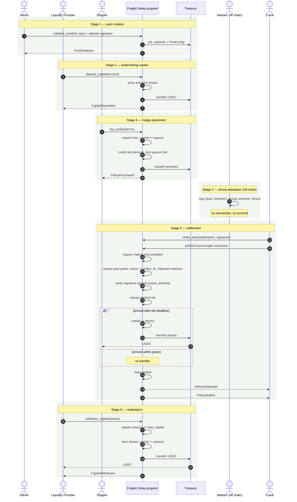
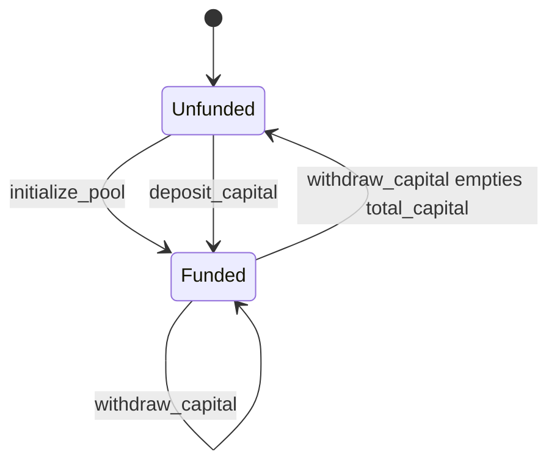
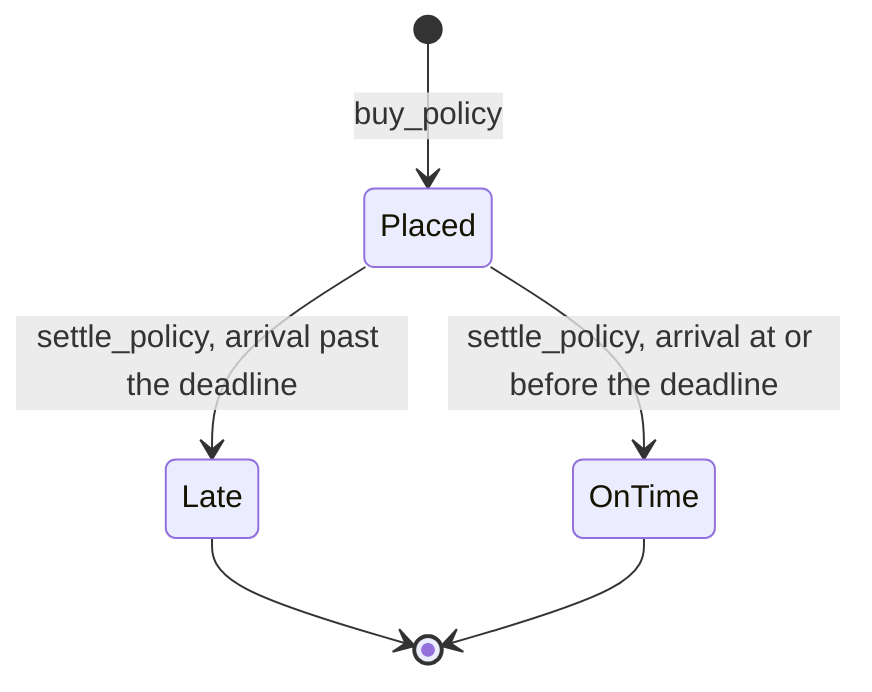
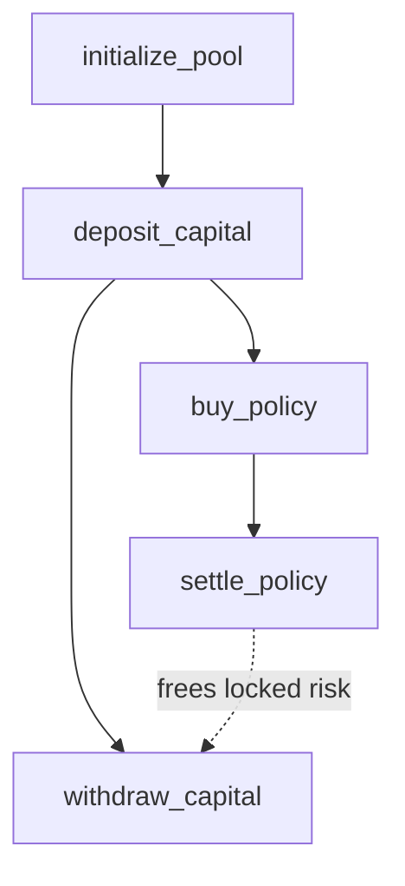

# Pool Lifecycle

The whole protocol, from initialisation to settlement, in the order it happens.

## End-to-end sequence

Stages 2 and 3 can interleave freely: policies can be sold the moment the pool
holds capital, and more capital can arrive while policies are live.

Stage 4 is deliberately not a transaction. The attester signs the arrival and
stops; nothing is written on chain until a crank relays that signature during
settlement. So the signature is not a prerequisite step so much as an input to
stage 5.

Stage 5 is permissionless but not automatic. Nothing calls `settle_policy` on
its own, so a policy waits for a crank — and its payout stays in
`total_locked_risk`, outside `free_capital`, until one runs. Every policy does
become settleable once its deadline passes, so this is a liveness concern rather
than a stranded-capital one; see [Invariants](/freight_delay/protocol/invariants)
for why.

## Pool state machine

Every instruction that touches the pool appears here. There is no
attestation-only instruction any more: an arrival reaches the program purely as
instruction data to `settle_policy`.

There is no terminal or frozen state. The pool has no pause, no shutdown, and no
migration path; it is a permanent state machine.

## Policy state machine

`Late` and `OnTime` are both terminal, distinguished by the `is_paid` flag.

`Placed` is the transient state. Both transitions out of it require a valid
signed attestation, but every policy acquires one option to leave: once
`now >= expected_delivery + grace_period`, any attested arrival — early or late —
is enough, and a non-triggering arrival still releases the locked risk. A policy
sits in `Placed` only until a crank settles it.

The state machine has no timeout edge, by design: the trigger is terminal
arrival, and a timeout would pay in the total-loss case that cargo insurance
already covers.

## Instruction dependency graph

Read the dotted edge as the only coupling between settlement and redemption:
`settle_policy` lowers `total_locked_risk`, which raises `free_capital`, which is
the ceiling on `withdraw_capital`. Until policies settle, LP capital is not fully
withdrawable.

## Next

- [Instructions](/freight_delay/protocol/instructions) — the guards at each step
- [Invariants](/freight_delay/protocol/invariants) — what settlement must preserve
