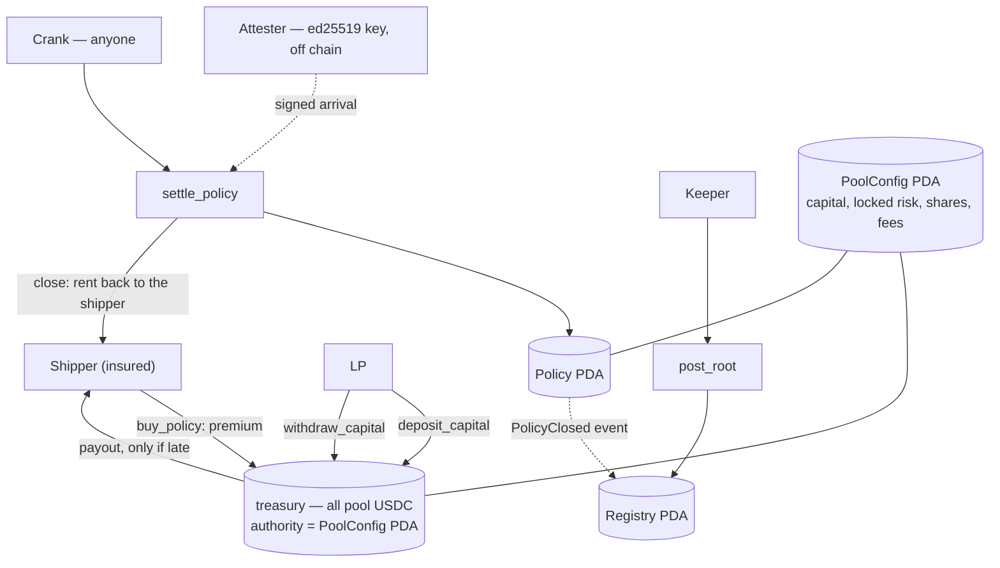

# freight_delay

The Anchor program behind the freight-delay protocol: a parametric indemnity pool on
Solana.

One pool per USDC mint. Liquidity providers deposit USDC and receive shares.
Shippers buy a policy that pays out when the attested arrival for their shipment
lands past the quoted delivery time plus a grace period. A single oracle
authority writes those delivery milestones, and settlement is permissionless —
anyone can crank it once a policy's deadline has passed.

The pool is **fully collateralised at all times**: every outstanding payout is
backed by capital the pool already holds, and that invariant is re-checked after
every state change.

Program ID: `4BtUosFfNUySEGAGspfjvStCzLzqSRdfoc4Z3Z1uqGJs` — deployed on **devnet**
([explorer](https://explorer.solana.com/address/4BtUosFfNUySEGAGspfjvStCzLzqSRdfoc4Z3Z1uqGJs?cluster=devnet))
and the same id on localnet, because the deploy reuses the checked-in program
keypair. The deployment record, the cluster details and the full architecture
write-up are in the [root README](../README.md#deployed-on-devnet).

## Architecture


<details>
<summary>Diagram source (mermaid)</summary>



</details>

Settlement is the only place risk leaves the pool, and the only place money does:
the payout is a transfer from the treasury, and every handler that moves capital
ends with `assert_solvent()` — `total_locked_risk <= total_capital`. The guards at
each step are listed in [`../docs/freight_delay/protocol/instructions.md`](../docs/freight_delay/protocol/instructions.md).

## Layout

```text
freight_delay/
├── Anchor.toml               # cluster, wallet, program id, [scripts] test
├── Cargo.toml                # workspace + release profile
├── txtx.yml                  # localnet / devnet environments for the deploy runbook
├── programs/freight_delay/
│   ├── Cargo.toml            # anchor-lang + anchor-spl 1.2.0, LiteSVM dev-deps
│   ├── src/
│   │   ├── lib.rs            # #[program] — six instructions, forwarding ctx.bumps
│   │   ├── instructions.rs   # flat `pub mod` + `pub use` list
│   │   ├── instructions/     # one file per instruction: Accounts struct + handler
│   │   ├── state.rs          # PoolConfig, LpPosition, Policy
│   │   ├── constants.rs      # PDA seeds, FEE_DENOMINATOR, the SLA horizon, the id window
│   │   ├── error.rs          # Freight DelayError — 14 flat variants
│   │   └── events.rs         # eight events (settle_policy emits three)
│   └── tests/test_freight_delay.rs  # 31 integration tests (7 more unit tests in shared.rs)
├── client/program.ts         # lifecycle harness over the generated client
├── client/generated/         # Codama client generated from target/idl — do not hand-edit
├── scripts/lifecycle.ts      # local MVP walkthrough — TS + surfpool
├── scripts/codegen.ts        # regenerates client/generated from the IDL
└── runbooks/                 # Surfpool deployment scaffolding (has its own README)
```

## Toolchain

Everything comes from the repository's `mise.toml`, one directory up; nothing
needs installing by hand:

```bash
mise trust mise.toml   # once per clone: mise gates config files by path
mise install           # agave, otter-sec/anchor, surfpool, cargo-nextest, sccache, bun
```

`mise` finds that file from anywhere in the repository, so the commands below work
from `freight_delay/` or from the root.

The Anchor pin is the `otter-sec/anchor` fork, and the Rust channel plus
components come from `../rust-toolchain.toml`. `sccache` is wired in as the
`rustc-wrapper` through `../.cargo/config.toml`.

Program dependencies are deliberately narrow: `anchor-lang` 1.2.0 (with
`init-if-needed`, used only by `deposit_capital`) and `anchor-spl` 1.2.0, plus
`solana-instructions-sysvar` and `solana-sdk-ids` — both already in the tree via
`anchor-lang`, pulled in directly so the sysvar binding and the ed25519 program id
come from crates rather than literals. The
release profile turns on `overflow-checks` with `lto = "fat"` and
`codegen-units = 1`.

## Build and test

```bash
cd freight_delay
anchor build                  # -> target/deploy/freight_delay.so
cargo nextest run             # 38 tests, color when stdout is a terminal
anchor test                   # runs Anchor.toml [scripts].test: nextest with --color always
cargo check --all-targets     # fast type-check loop
bun run devnet-e2e            # the lifecycle against the deployed devnet program
```

**Build first, always.** `tests/test_freight_delay.rs` loads `target/deploy/freight_delay.so`
with `include_bytes!` at compile time, so running the tests against a stale build
silently tests old code. `cargo test` is not the test command; `cargo nextest run`
is.

## Test evidence


The USDC in the devnet run is **demo money**: `scripts/devnet-e2e.ts` creates its own
6-decimal SPL token and mints it to itself. It is not Circle's USDC, it came from no
faucet, and it holds no value — a fresh mint per run, so no real balance is touched. The
program checks only the mint's decimals (`decimals == 6`), nothing about its issuer.

`cargo nextest run` drives the built `.so` in-process through LiteSVM, so it covers
every guard and every rejection path without paying fees. `bun run devnet-e2e`
(`scripts/devnet-e2e.ts`) proves the *deployed* binary on devnet end to end:
`initialize_pool` → `deposit_capital` → `buy_policy` ×2 → `settle_policy` for a late
and an on-time arrival → `post_root`, asserting the pool's accounting after each
step. It cannot time-travel the way the local walkthrough does, so it buys a policy
whose deadline is 30 seconds out and polls the cluster clock until it passes — the
script retries on the public RPC's HTTP 429s.

## How it works

| Role | Does |
|---|---|
| Admin | `initialize_pool` once: sets `fee_bps` and the oracle authority, and creates the pool's treasury token account. |
| LP | `deposit_capital` mints shares against the pool. `withdraw_capital` burns them for a share of the capital that is not locked against outstanding payouts. |
| Shipper | `buy_policy` pays a premium, credited to the pool net of fee, and locks the policy's payout against the pool's capital. |
| Attester (off chain) | Signs an arrival — `(shipment_id, actual_delivery, terminal_code, nonce)` — with its ed25519 key. Writes nothing on chain. |
| Crank — anyone | `settle_policy` relays that signature after the deadline, pays the shipper if the attested arrival is past it. |

### PDAs

| Account | Seeds | Notes |
|---|---|---|
| `PoolConfig` | `[b"config", usdc_mint, oracle_authority]` | All pool accounting lives here. The attester's key is part of the address, so the pool for a given attester cannot be created — or squatted — by anyone else. |
| treasury | `[b"treasury", config]` | An SPL token account owned by the token program, with `PoolConfig` as its authority — the only account the program signs for. |
| `LpPosition` | `[b"lp_position", config, lp]` | Share balance per LP. |
| `Policy` | `[b"policy", config, policy_id_le]` | One per purchase. |

There is no delivery seed: an attested arrival is a signed message, not an account.

### Instructions

| Instruction | Signer | Effect | Notable guards |
|---|---|---|---|
| `initialize_pool` | admin + attester | Creates `PoolConfig` and the treasury | `fee_bps < 10_000`; the attester must sign |
| `deposit_capital` | LP | USDC → treasury, mints shares | `amount != 0`, `shares != 0` |
| `buy_policy` | shipper | Premium → treasury, locks payout risk | `payout != 0`, `premium != 0`, `expected_delivery > now`, `grace_period >= 0`, deadline inside `MAX_SLA_SECONDS`, `policy_id` within `MAX_POLICY_ID_GAP`, `free_capital >= payout` |
| `settle_policy` | any signer | Pays the shipper iff delayed, always releases the locked risk | not already settled, `now >= expected_delivery + grace_period`, attestation shipment matches the policy's, `nonce == policy.policy_id`, ed25519 signature verified against `oracle_authority` |
| `withdraw_capital` | LP | Treasury → LP, burns shares | `shares != 0`, `shares <= position.shares`, `amount != 0`, `amount <= free_capital` |

The full guard list, with the account-level constraints that act as guards too
(`associated_token::authority`, `token::authority = config`, bump pinning), is in
[`../docs/freight_delay/protocol/instructions.md`](../docs/freight_delay/protocol/instructions.md).

### Accounting

`PoolConfig` is the single source of truth:

```text
free_capital() = total_capital - total_locked_risk        (saturating)
solvency      : total_locked_risk <= total_capital        (assert_solvent)
```

- **Deposit** — `shares = amount` for the first deposit, otherwise
  `amount * total_shares / total_capital`.
- **Buy** — `fee = premium * fee_bps / 10_000`, `net = premium - fee`; the pool
  credits `net` to `total_capital`, adds `fee` to `total_fees`, and adds the
  payout to `total_locked_risk`. The transfer is for the **gross** premium.
- **Withdraw** — `amount = shares * total_capital / total_shares`, capped by
  `free_capital`.
- **Settle** — `total_locked_risk -= payout` always; on a triggered policy the
  pool also debits `total_capital`, transfers the payout to the shipper and sets
  `is_paid`. The trigger is `actual_delivery > expected_delivery + grace_period`.

All money math goes `u64 → u128 → checked_* → u64::try_from`, and every division
floors, so rounding never leaves the pool short. `fee_bps` is basis points against
`FEE_DENOMINATOR = 10_000`.

Two orderings are deliberate and easy to break. The solvency gate in `buy_policy`
reads `free_capital` **before** the premium is credited, so a premium can never
fund its own payout. And every state-mutating handler ends with
`config.assert_solvent()` and only then emits its event.

## Test harness

- **LiteSVM**, not `anchor-client` and not a validator: `litesvm` +
  `litesvm-token`, with `solana-awesome` re-exports. 31 of the 38 tests live in
  `programs/freight_delay/tests/test_freight_delay.rs`; the other 7 are unit tests
  of the ed25519 precompile parsing in `src/instructions/shared.rs`.
- Each test builds a fresh `LiteSVM` through `setup()`, airdrops four keypairs and
  creates the USDC mint plus both ATAs. There is no shared fixture, so tests
  cannot leak state into one another.
- Time is set explicitly with `set_ts()`, which writes the `Clock` sysvar. Nothing
  sleeps or waits on wall-clock time.
- Most assertions read events: `parse_event()` scans `Program data:` logs for the
  expected discriminator rather than inspecting account state.

## Known limitations

These are design decisions, not bugs:

- Settlement requires a valid signed attestation. A policy whose shipment was
  never attested keeps its payout locked in `total_locked_risk` forever — there is
  no timeout and no refund path.
- The attester is a single key. Its signature is cryptographically verified, but
  there is no decentralisation: a compromised `oracle_authority` settles falsely
  and cannot be rotated.
- There are no setters for `fee_bps` or `oracle_authority` after initialisation.

[`../docs/freight_delay/appendix/loi-divergences.md`](../docs/freight_delay/appendix/loi-divergences.md)
has the full list of divergences from the design document.

## Conventions

- A handler's body lives in `impl<'info> X<'info>` in that instruction's own file;
  `lib.rs` only forwards `ctx.bumps`.
- Register a new handler in **both** `instructions.rs` and `lib.rs`.
- Never reorder fields in an `#[account]` struct or arguments in an instruction:
  both layouts are positional, and `InitSpace` silently recomputes rather than
  erroring. Never edit a seed literal or `declare_id!` — every PDA address derives
  from them.
- Account space is always `8 + X::INIT_SPACE`; new accounts are filled with
  `set_inner`.

## Where to read more

- [`../docs/freight_delay/protocol/architecture.md`](../docs/freight_delay/protocol/architecture.md) — how the
  accounts and instructions fit together
- [`../docs/freight_delay/protocol/invariants.md`](../docs/freight_delay/protocol/invariants.md) — the
  accounting rules
- [`../docs/freight_delay/workflows/lifecycle.md`](../docs/freight_delay/workflows/lifecycle.md) — the pool's
  life from initialisation to settlement
